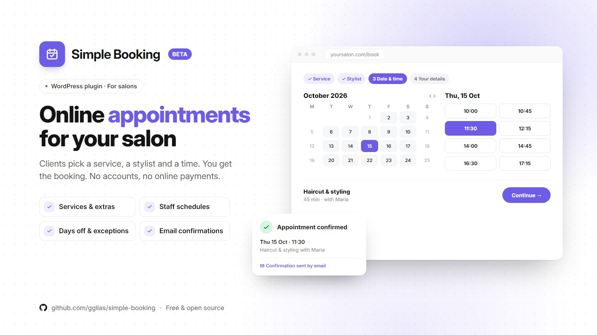

# Simple Booking beta

Online appointment booking for a single hair salon in WordPress. Clients pick a service, a stylist and a time, and book as guests: no accounts, no online payments.

> [!WARNING]
> **Beta, still in development. Not ready for live sites yet.** There is no release to download. A stable version will be published in [Releases](../../releases) once testing is done.

> [!NOTE]
> **Built at Smartup.** This plugin was made at [Smartup](https://smartupweb.com) and may show the Smartup name by default in some places that can't be changed from the admin.
>
> **Need a white-label version?** Send me a message or email me at **[gglias.pro@gmail.com](mailto:gglias.pro@gmail.com)** and tell me what you need.

## Features

- **Services and extras.** Each service has its own duration and price, and optional add-ons.
- **Staff.** A fixed team of stylists, each with a weekly schedule.
- **Days off and exceptions.** Close the salon, or block a single stylist, for specific dates.
- **Real availability.** Clients only see time slots that are actually free.
- **Guest booking.** No customer accounts. Clients get an email confirmation and a link to their appointment.
- **Staff notifications.** The team gets an email for every new booking.
- **Admin calendar.** See and manage all appointments in wp-admin.

Prices are stored in euros, and times follow the salon's own time zone.

## Shortcodes

| Shortcode | What it does |
| :-- | :-- |
| `[simple_booking]` | The booking form |
| `[simple_booking_appointment]` | The page where a client views their appointment |

## Requirements

- WordPress 6.4 or newer
- PHP 8.0 or newer

## Availability

Not available to download yet. The code is here so you can follow its progress. When the first stable version is ready, it will appear in [Releases](../../releases) with install instructions.

## License

[GPL-2.0-or-later](LICENSE).

Made by **GG** · [Greg Glias](https://gglias.github.io)
